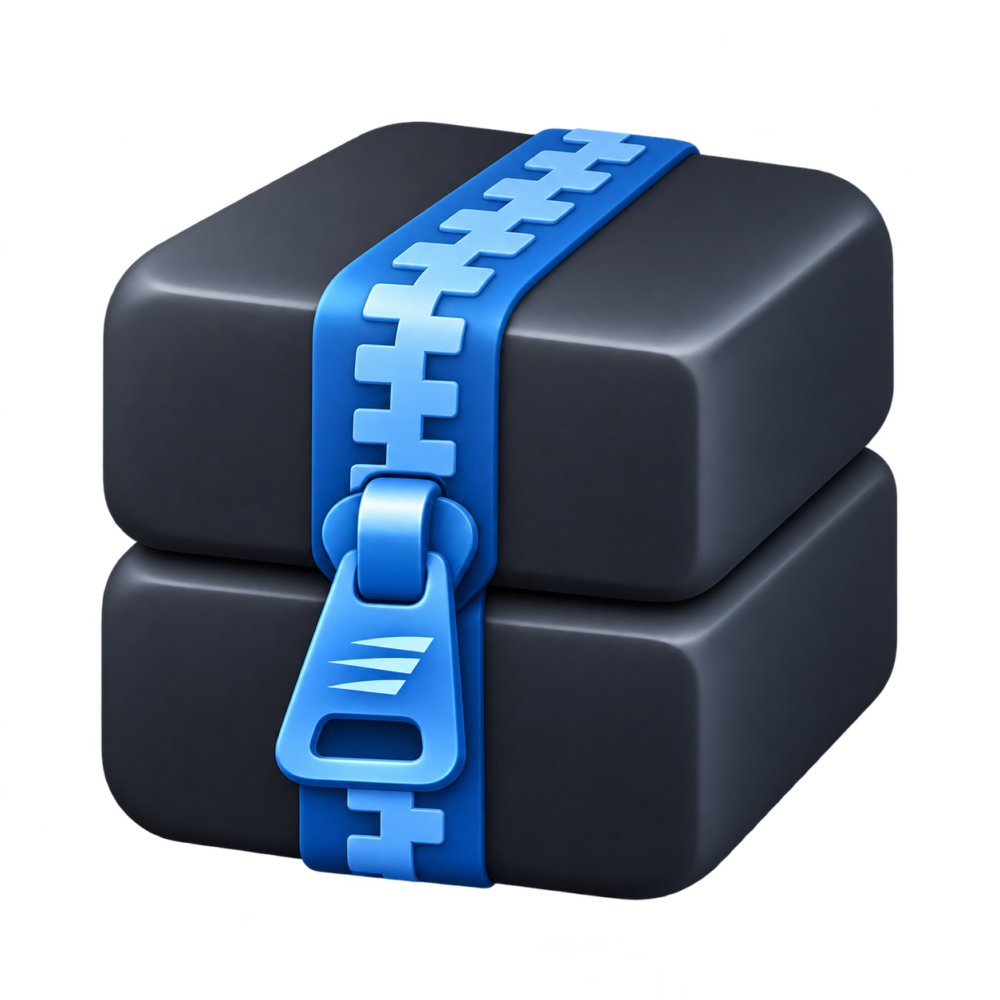

<p align="center"></p>

# 7Zipper

Windows용 7z·ZIP 압축 프로그램. 공식 LZMA SDK와 Zstandard 기반 네이티브 엔진, 한국어 WPF 화면, 다중 코어 처리 지원.

**공식 7-Zip 프로젝트와 별개의 프로그램.**

## 01 / 설치 및 실행

- 지원 대상: Windows 10 22H2·Windows 11, x64.
- [Releases](https://github.com/yunhyok/7zipper/releases)에서 설치판 또는 포터블 ZIP 다운로드.
- 설치 기본 경로: `C:\Program Files\7Zipper`. 설치 화면에서 드라이브·폴더 변경 가능.
- .NET 런타임 별도 설치 불필요.
- 탐색기 메뉴는 설치판에서 선택 가능. Windows 11에서는 **더 많은 옵션 표시**에서 사용.
- 첫 릴리스는 코드 서명 미적용. Windows의 확인 화면이 표시될 수 있음.

## 02 / 주요 기능

| 구분 | 지원 내용 |
|---|---|
| 기본 압축 | 7z / LZMA2 |
| ZIP | Deflate·Store·Zstandard, ZIP64 |
| 암호 | 7z AES-256·파일명 암호화, ZIP AES-256, 기존 ZipCrypto 해제 |
| 폴더별 압축 | 선택한 폴더마다 별도 압축파일 생성 |
| 분할 압축 | 7z `.7z.001…`, ZIP `.z01…` + 마지막 `.zip` |
| 목록 | 폴더 탐색·전체 검색·선택 해제·무결성 검사 |
| 알아서풀기 | 단일 파일·단일 최상위 폴더는 지정 위치에 해제. 여러 최상위 항목은 압축파일 이름의 새 폴더에 해제 |
| 드래그앤드롭 | 파일·폴더를 넣어 압축, 압축파일을 넣어 열기, 내부 항목을 탐색기로 끌어내어 해제 |

ZIP Zstandard는 압축 방식 93을 지원하는 프로그램 필요. UTF-8 표시가 없는 ZIP 파일명은 Unix·macOS 작성본이면 UTF-8, 그 외는 Windows OEM 코드페이지(한국어 Windows는 CP949)로 해석. 7z 읽기는 공식 LZMA SDK에 포함된 LZMA/LZMA2/PPMd/Copy 및 필터에 한정. Deflate64 ZIP, SDK에 없는 7z 코덱, RAR·EGG·ALZ는 미지원.

분할 파일은 같은 폴더에 모두 보관할 것. 7z는 첫 `.001`, ZIP은 마지막 `.zip`으로 열기. 다른 조각을 선택해도 시작 파일 자동 검색.

## 03 / 성능과 데이터 보호

- 논리 프로세서 전체를 기본 예산으로 사용. 고급 설정에서 스레드·메모리 한도 변경 가능.
- LZMA2 코덱 내부 병렬 처리, ZIP 파일별 병렬 처리, 폴더별 압축·여러 압축파일 해제의 작업 병렬 처리.
- 모든 압축파일의 해제가 같은 비율로 빨라지지는 않음. 솔리드 압축·단일 스트림의 의존성과 디스크 속도에 따라 제한.
- 압축·해제는 별도 작업 프로세스에서 실행. 취소, 프로세스 메모리 한도, 임시 출력 후 게시 적용.
- 기존 압축파일과 같은 출력 이름은 새 이름으로 생성. 해제 충돌은 덮어쓰기·건너뛰기·이름 변경 선택.
- 암호는 명령줄·로그·설정 파일에 저장하지 않음. 경로 이탈, Windows 장치명·ADS·링크 항목 차단.
- 인터넷에서 받은 압축파일의 영역 표시는 해제한 파일에 전달. FAT32·exFAT처럼 대체 데이터 스트림이 없는 볼륨에서는 생략.
- 탐색기로 끌어내기는 임시 해제 공간 필요. 준비 중 마우스를 놓으면 준비 완료 후 다시 끌 것. 복사가 끝날 때까지 임시 파일 유지.
- 비정상 종료 후 남은 드래그 임시 파일은 자동 삭제하지 않음. 재부팅 후 `%LOCALAPPDATA%\7Zipper\Drag`에서 수동 정리 가능.
- 취소 시 이미 완료한 별도 작업·해제 파일은 유지될 수 있음. 기존 압축파일 내부 편집과 자동 업데이트는 미지원.

## 04 / 소스 빌드

필수 도구: .NET SDK 10.0.404, Visual Studio C++ Build Tools(x64·Windows SDK), CMake 3.21 이상, Ninja, PowerShell 7. 설치판 생성은 Inno Setup 7 추가 필요.

```powershell
pwsh ./scripts/build.ps1 -Test -Publish -Installer
```

압축 의존성은 `scripts/fetch-native.ps1`에서 고정 버전·SHA-256 확인 후 `third_party`에 내려받음. 출력은 `artifacts/publish`, 배포 파일은 `dist`.

관리 코드 경로 검사만 실행:

```powershell
dotnet run --project tests/SevenZipper.Tests -c Release -- --managed
```

네이티브 엔진 검사, UI·배포 검증 범위와 실측 결과는 [검증 기록](docs/validation.md) 참조.

## 05 / 구성 및 라이선스

- `src/Core`: 파일 작업, 자원 예산, 프로세스 통신, 충돌 처리.
- `src/Native`: LZMA SDK·minizip-ng·Zstandard 연결.
- `src/App`: 한국어 WPF 화면.
- `src/Shell`: 탐색기 명령과 OLE 드래그 수명 관리.

자체 코드 MIT. 외부 구성요소의 원문 고지는 [THIRD-PARTY-NOTICES.md](THIRD-PARTY-NOTICES.md)에 포함. 아이콘은 이 프로젝트를 위해 생성한 원본 디자인.
